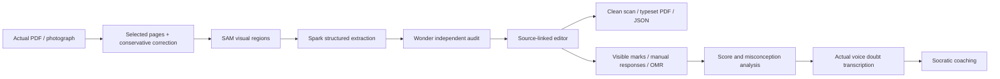

# PaperBridge — from scan to editable exam

A standalone Meta AI hackathon application for turning an **actual uploaded PDF or photograph** into editable questions, preserved diagram crops, and a clean digital paper. Students can also review the paper they attempted using visible marks, their own responses, or an uploaded OMR.

There is no preloaded question bank, authored demonstration question, fabricated transcript, or offline answer path. Without a working Meta API key, live extraction reports an error. Uploaded exam papers and generated private exports are not included in this public repository.

## Run independently

Requires Node 24 LTS and Python 3.12+. No ClarifyCue checkout or database is needed.

```sh
npm ci --ignore-scripts
python -m venv .venv
# Activate .venv using your operating system's normal command.
python -m pip install -r requirements.txt
npm run setup
```

Set `MODEL_API_KEY` in the ignored `.env`. Set `PYTHON` to your environment's Python executable, then run:

```sh
npm start
```

Open http://localhost:4310. Local judge credentials are generated randomly in the ignored `JUDGE-ACCESS.local.md`. For deployment, configure the credentials and session secret privately; never publish `.env`.

Docker includes Node, Python, document processing and math rendering:

```sh
npm run setup
# Configure MODEL_API_KEY and the public APP_URL in .env first.
docker compose up --build
```

## The real-document workflow

1. **Load the PDF locally.** Every page is available through a paginated thumbnail browser, including long PDFs. Select or deselect any pages, up to **three** for the judge run. Loading thumbnails, navigating and selecting use no Meta inference.
2. **Correct the source.** Photographed pages can receive conservative perspective, rotation and illumination corrections. The original remains beside the processed page. Curved folds and lost pixels are not magically reconstructed.
3. **Process one chosen page.** Text-dominant pages use one Standard-mode Muse Spark request, skipping SAM and Wonder. Visual pages offer a two-request economy path (SAM + Spark) or a four-request focused path with layout coverage and one recovery attempt. Graphical choices and diagrams are cropped from the upload rather than redrawn. Request caps are enforced on the server; token costs still depend on content.
4. **Verify only what you choose.** Muse Wonder runs on one explicitly selected question, capped at two requests. A high-confidence key disagreement can trigger one bounded repair, accepted only after a second agreeing audit. Other questions remain marked “not requested.” Supplied keys are never autonomously overwritten.
5. **Review and edit.** Correct text, LaTeX, option text, question numbers and crop coordinates. Edits invalidate old audits. Each question remains linked to its source page and full question crop.
6. **Export.** Download a cleaned source PDF, a typeset question paper PDF, or editable structured JSON. PDF exports contain current uploaded/edited content, without printing the answer key. Unsupported formula rendering is reported; where available, the original question crop preserves the source instead of inventing a formula.

Instruction/blank pages can be retained without inventing questions. Unreadable question pages return a visible error. A missed question can be selected directly on its source image and recovered with one Spark request. Current limits are 25 MB, three processed pages per judge paper and 200 single-correct MCQs. The PDF page browser has no fixed 100-page restriction and renders thumbnails in local batches of 24. Numerical and multiple-correct formats are explicitly outside this release.

The four model roles are visible at the very top of the introduction and workspace. The introduction can show a before/after preview generated from a real uploaded page, plus actual verification counts. It uses saved processing evidence and local PDF rendering, without calling Meta. Uploaded content and preview images remain runtime data, outside the public source repository. See [Meta's pricing reference](https://dev.meta.ai/docs/pricing-rate-limits) for current model rates; this app uses Standard mode rather than the training-enabled Contributor variants.

## Student analysis

The uploaded paper is not enough to infer a student's score. PaperBridge offers three response inputs:

- **Visible marks:** Spark may propose ticks/circles actually visible next to options. Low-confidence and multiple marks remain blank.
- **OMR / response sheet:** Upload an image or the first PDF page. Match rows by printed question number, never by assumed array position. Unmatched and uncertain rows remain unresolved.
- **Manual entry:** Enter or correct the responses the student actually marked.

All detected selections require review before analysis. A supplied coaching/official key becomes the scoring reference but is not certified as official. Otherwise scores remain labelled estimates against AI-derived/edited keys. Reports show correct, incorrect and unattempted responses, topic-level marks lost, and distractor misconceptions. No mastery or learning-gain claim is inferred from a tiny paper selection.

Muse Voice Transcribe 1.0 transcribes actual recorded PCM WAV doubts in English/Hinglish. Spark then offers a Socratic guiding step for the selected question. Optional speech playback uses the browser, not a claimed Meta TTS model.

## Architecture and separation



The server contains no private ClarifyCue source package, Prisma client, database schema or core database credential. A narrow optional external-publication connector remains documented in [API_CONTRACT.md](docs/API_CONTRACT.md); the judge interface focuses on digitization and student analysis. ClarifyCue is not required to run it.

Model protocols follow Meta's official [model reference](https://dev.meta.ai/docs/models), [SAM output grammar](https://dev.meta.ai/docs/sam/reading-segmentation), and [recording transcription protocol](https://dev.meta.ai/docs/speech-to-text). Catalogue connectivity and per-question verification are distinct signals.

## Verification and deployment

```sh
npm run check
npm test
python -m unittest discover -s test -p 'test_*.py'
```

Automated provider doubles exist only inside tests to verify failure handling, access isolation, editing, audit invalidation, response matching and grading. They are not reachable as a product mode or content endpoint. Live QA uses a representative page from each provided format; it does not process or align the complete papers and is not an accuracy benchmark.

See the [judge walkthrough](docs/JUDGE_GUIDE.md) and [deployment guidance](docs/DEPLOYMENT.md). The intended public hostname is `hackathon.clarifycue.com`, on a separate service and repository. Cloud Run's temporary filesystem is not durable: use the private `DATA_BUCKET` adapter for cloud hosting. It uses service-account identity and object-generation preconditions; file storage is for a single local process or persistent Docker volume. Establish a retention policy before broader public use.
